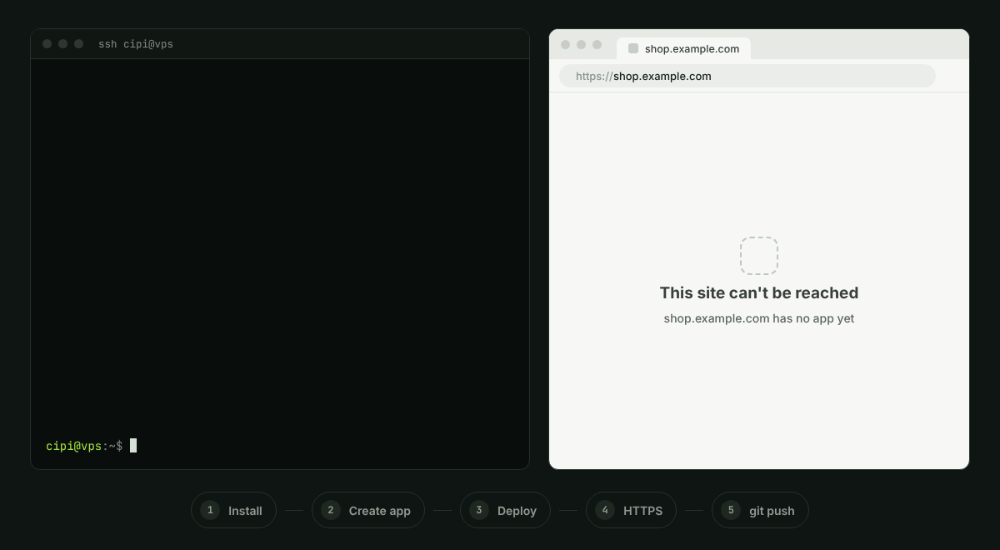

<div align="center">

<a href="https://cipi.sh">
  <picture>
    <source media="(prefers-color-scheme: dark)" srcset="https://cipi.sh/brand/cipi-logo-dark.svg">
    
  </picture>
</a>

## Deploy Laravel to servers you own.

One command turns a fresh Ubuntu VPS into a production host for all your Laravel and PHP apps.<br>
Isolated, patched, zero-downtime. No panel needed, no SaaS behind it, no monthly fee.

[](https://github.com/cipi-sh/cipi/releases)
[](LICENSE)
[](https://cipi.sh/docs/installation)

<br>

<a href="https://cipi.sh">
  
</a>

<sub>Install, create, deploy, HTTPS, <code>git push</code>. In real life the install takes about ten minutes and the rest a few more.</sub>

</div>

<br>

## Live in about 15 minutes

On a fresh Ubuntu 24.04 or 26.04 server, over SSH (the install takes about ten minutes):

```bash
wget -O - https://cipi.sh/setup.sh | bash
```

Then ship your app:

```bash
cipi app create          # pick Laravel, a domain and your Git repo (a few minutes)
cipi deploy myapp        # atomic release, instant rollback (about a minute)
cipi ssl install myapp   # HTTPS with Let's Encrypt (seconds)
```

About 15 minutes from a fresh server to a live app with HTTPS. **[Follow the 15-minute guide →](https://cipi.sh/guides/deploy-laravel-ubuntu-vps)**

<br>

## Why use Cipi

|                                   |                                                                                                    |
| --------------------------------- | -------------------------------------------------------------------------------------------------- |
| **Every app in its own box**      | Its own Linux user, PHP-FPM pool, database and Valkey. One hacked site can't read the others.      |
| **Secure from the first boot**    | Key-only SSH, UFW, Fail2ban, optional CrowdSec and Cloudflare Zero Trust. PHP CVEs patched overnight. |
| **Deploys that don't break**      | Releases with a symlink swap, health checks, automatic rollback, deploy on `git push`.             |
| **Settings live in your repo**    | One [`cipi.yml`](https://cipi.sh/cipi-yml) for workers, cron, domains, redirects and backups.      |
| **The whole Laravel stack**       | PHP 8.3 to 8.6, Octane, Horizon, Reverb, Scout with Meilisearch, MariaDB or PostgreSQL, Node frontends. |
| **Backups and alerts built in**   | Encrypted backups to any S3 bucket; alerts on Slack, Telegram, email, Discord and more.             |
| **AI agent ready**                | An [MCP server](https://cipi.sh/mcp) lets Claude or Cursor read logs and deploy, with limits you set. |
| **Yours, end to end**             | MIT licensed, no telemetry, no account. An optional [web GUI](https://cipi.sh/docs/gui) and [REST API](https://cipi.sh/api) if you want them. |

<br>

## Coming from somewhere else?

Every comparison is honest about when the other tool is the better pick, and ends with a step-by-step move to Cipi.

| Coming from | What changes with Cipi | |
| --- | --- | --- |
| **Laravel Forge** | Same Laravel workflow, run from inside your server. No account fee, settings in Git. | [Compare and migrate](https://cipi.sh/alternative-to-laravel-forge) |
| **Ploi** | Zero-downtime deploys, queues, SSL and backups, without paying per server. | [Compare and migrate](https://cipi.sh/alternative-to-ploi) |
| **Laravel Cloud** | A fixed VPS bill instead of plans plus usage, with root access and nothing to lock you in. | [Compare and migrate](https://cipi.sh/alternative-to-laravel-cloud) |
| **Coolify** | No containers for PHP: Laravel runs natively, with workers, Horizon, Reverb and Octane built in. | [Compare and migrate](https://cipi.sh/alternative-to-coolify) |
| **cPanel / Plesk** | Your own apps only, isolated and deployed from Git, without the mail, DNS and reseller weight. | [cPanel](https://cipi.sh/alternative-to-cpanel) · [Plesk](https://cipi.sh/alternative-to-plesk) |

<sub>Also compared: RunCloud, ServerPilot, CloudPanel, Kamal, Dokku, Vito Deploy and more, in <a href="https://cipi.sh/alternatives">all comparisons</a>.</sub>

<br>

## Requirements

- Ubuntu **24.04 LTS** or **26.04 LTS**, freshly installed
- A KVM/VMware/Hyper-V/Xen VM or bare metal (not OpenVZ, LXC or Docker)
- A user with `sudo`, and ports **22**, **80**, **443** open

Works on Hetzner, DigitalOcean, AWS, Vultr, Linode, OVHcloud, Scaleway, Google Cloud and any other provider that gives you a real VM.

<br>

<div align="center">

### [Read the docs](https://cipi.sh/docs) · [Browse the guides](https://cipi.sh/guides) · [Report a bug](https://github.com/cipi-sh/cipi/issues)

Open source since 2019, MIT licensed. Made in Italy by [Andrea Pollastri](https://web.ap.it).<br>
If Cipi saves you time, a ⭐ helps other people find it.

</div>
